<p align="center">
  <picture>
    <source media="(prefers-color-scheme: dark) and (prefers-reduced-motion: reduce)" srcset="assets/hero-dark-en-static.svg">
    <source media="(prefers-color-scheme: light) and (prefers-reduced-motion: reduce)" srcset="assets/hero-light-en-static.svg">
    <source media="(prefers-color-scheme: dark)" srcset="assets/hero-dark-en.svg">
    <source media="(prefers-color-scheme: light)" srcset="assets/hero-light-en.svg">
    
  </picture>
</p>

<p align="center">
  <a href="#quick-start"></a>
  <a href="https://www.remotion.dev"></a>
  <a href="#requirements"></a>
  <a href="LICENSE"></a>
  <a href="README.md"></a>
  <a href="README.en.md"></a>
</p>

<p align="center"><b>Train your style. Claude edits your reels.</b></p>

<p align="center">
Video Editor Architect is a reel editor you run with Claude Code. You train <b>your</b> editing style (subtitles, keyword cards, pacing, cuts, sound) from your own reels or from creators you like. Then Claude edits your raw footage with it: it decides what goes on screen and when, deterministic scripts do the math and <a href="https://www.remotion.dev">Remotion</a> renders the MP4. If you post reels often and you're tired of explaining to every editor how you like them, it's for you.
</p>

<p align="center">
  <a href="#what-it-looks-like">What it looks like</a> ·
  <a href="#quick-start">Quick start</a> ·
  <a href="#what-it-does">What it does</a> ·
  <a href="#requirements">Requirements</a> ·
  <a href="#how-your-style-is-stored">Your style</a> ·
  <a href="#skills">Skills</a> ·
  <a href="#keys-and-spending">Keys and spending</a> ·
  <a href="#faq">FAQ</a> ·
  <a href="#about">About</a>
</p>

---

## What it looks like

You type `/empezar` and the setup agent walks you through it, one question at a time. This is how it starts (trimmed):

```text
You       /empezar

Claude    ¿En qué idioma prefieres que trabajemos: español o inglés? /
          Which language do you prefer: Spanish or English?

You       English.

Claude    Checking your install with the doctor (read only).
          ✓ Node 24 · ✓ ffmpeg · ✓ whisper.cpp and its models · ✗ yt-dlp
          yt-dlp is missing; it downloads your reels for free. Run this
          and tell me when it's done:  brew install yt-dlp

You       Done.

Claude    The doctor is all green. What should I call you?
          ...

Claude    Where does your style come from?
          a) Your own published reels (free with yt-dlp or a folder of MP4s)
          b) Creators you name as reference
          c) Start with base-neutra and train later

You       a, my reels.

Claude    Got it. I'll fetch them from your profile with yt-dlp and measure
          subtitles, cards, pacing, framing and sound. You'll get a summary
          with every number and its n, then you hand me a raw video for
          the first reel.
```

If something costs money, Claude tells you how much and waits for your "yes" in that same turn.

## Quick start

**Before:** Node.js 24, Git and Claude Code signed in to your account. The [macOS](docs/install-macos.md) and [Windows](docs/install-windows.md) guides cover each one.

Create your private copy from the template (or use the **Use this template** button on GitHub) and go in:

```bash
gh repo create my-editor --template Hainrixz/video-editor-architect --private --clone
cd my-editor
npm ci
npm run instalar          # shows the plan: what is missing and how it gets installed
npm run instalar -- --si  # with your yes, installs it
claude
```

Inside Claude Code, type `/empezar` (it speaks English too; saying "start" also works).

`npm run instalar` only installs what your system (macOS or Windows) is missing: ffmpeg, whisper.cpp and its models, uv and Python, yt-dlp, Chromium and the fonts. It never uses `sudo` and never touches your keys; anything that needs your password is printed for you to run. Afterwards, `npx tsx herramientas/doctor.ts` confirms everything is there.

## What it does

### Train your style

<picture>
  <source media="(prefers-reduced-motion: reduce)" srcset="assets/banner-estilo-en-static.svg">
  
</picture>

You pick where it comes from: your own published reels (`/aprender-estilo`), creators you name (`/entrenar-estilo`), or `base-neutra` to edit today and train later. The result is a profile in `estilo/estilos/<id>/` that starts as `en-prueba` (testing) and becomes `aprobado` (approved) when you say so. Anything that could not be measured stays `N/A`, with a note on what is missing.

### Cuts without dead air

<picture>
  <source media="(prefers-reduced-motion: reduce)" srcset="assets/banner-cortes-en-static.svg">
  
</picture>

whisper.cpp transcribes your raw footage on your machine and Claude proposes the text without silences or repeated takes. You approve it before anything gets cut. If your style asks for it, the take is sped up without changing the pitch of your voice. The original is never touched.

### Subtitles and cards

<picture>
  <source media="(prefers-reduced-motion: reduce)" srcset="assets/banner-subtitulos-en-static.svg">
  
</picture>

Two-to-three-word subtitles with your style's size and position, and keyword cards with what you say, word for word. When you say "ask Claude…", a prompt card types itself in so viewers can copy it.

### The director

<picture>
  <source media="(prefers-reduced-motion: reduce)" srcset="assets/banner-director-en-static.svg">
  
</picture>

Claude decides what goes in and when: logos and stickers from your library, sound effects without repeats, your screenshots, and screen demos recorded with `/grabar-demo`. Its decisions go in `notas-director.json`, and your profile wins whenever it clashes with the draft.

### Render and review

<picture>
  <source media="(prefers-reduced-motion: reduce)" srcset="assets/banner-render-en-static.svg">
  
</picture>

Remotion renders at 1440×2560 (and 4K if your raw footage is 4K) at −14 LUFS / −1.5 dBTP. Before that, `validar.ts` checks the edit against fixed rules and reports "passes X of Y rules (Z N/A)"; after it, QA with contact sheets.

### Learns from your fixes

<picture>
  <source media="(prefers-reduced-motion: reduce)" srcset="assets/banner-aprende-en-static.svg">
  
</picture>

`/ajustar "<what to change>"` makes a new version (the previous one stays read-only). If it is a general preference, it goes to your profile in your own words, dated, so the next reel already starts with it.

## Requirements

| | macOS | Windows |
|---|---|---|
| Install guide | [docs/install-macos.md](docs/install-macos.md) | [docs/install-windows.md](docs/install-windows.md) |
| Node.js | 24 or newer | 24 or newer |
| Also needed | ffmpeg, whisper.cpp, Python with uv, Chrome | ffmpeg, whisper.cpp, Python with uv, Chrome |
| Claude Code | yes | yes |
| Face tracking and OCR | Apple Vision | Python (RapidOCR + MediaPipe in the uv `.venv`) |
| Claude Code sandbox | yes | no on native Windows (yes on WSL2) |

On native Windows the repo's rules still apply, but there is no sandbox enforcing them. If your whisper models live in another folder, the guides explain `EDITOR_WHISPER_MODELO`, `EDITOR_VAD_MODELO`, `EDITOR_VAD_CLI` and `EDITOR_MODELOS`.

## How your style is stored

Each style is a folder in `estilo/estilos/<id>/`:

- `perfil.md`: the rules in plain words, what never goes, reference numbers (each with its n and source) and the history of your corrections, word for word and dated.
- `perfil.json`: the same values for the code, with a `motor` section (speed, air cuts, safe zone, subtitles, cards, stickers and sound).
- `aprendizajes.md`: what worked and what didn't while training it.
- `fuentes.json`: the reels and profiles it was learned from.

The registry is `estilo/estilos/estilos.json`. You can have several styles; if you don't name one when editing, Claude asks which. Your profile (`creador.json`), your styles and `ESTADO.md` are meant to be committed to **your** private repo. More in [estilo/estilos/README.md](estilo/estilos/README.md).

Tool names, folders and flags are in Spanish (`herramientas/` = tools, `crudo` = raw footage, `proyectos/` = projects, `estilo/` = style, `biblioteca/` = library). Claude talks to you in English all the same.

## What this repo does NOT include

No videos, stickers, sound effects, memes, logos or font files. You add your own and record the license of each file in [biblioteca/LICENCIAS.md](biblioteca/LICENCIAS.md). The OFL fonts are downloaded from Google Fonts by a script. It doesn't ship anyone's style either: yours comes from your reels or from the creators you name.

## Skills

| Command | What it does |
|---|---|
| `/empezar` | Guided setup and first reel |
| `/editar` (or "edit this video") | Edits a raw video end to end with a style |
| `/ajustar` | Applies your corrections to an edited reel as a new version |
| `/aprender-estilo` | Learns your style from your own published reels |
| `/entrenar-estilo` | Trains a new style from creators you name |
| `/sfx` | Manages your sound-effects library |
| `/stickers` | Brand logos and your own PNG stickers |
| `/grabar-demo` | Records a web screen demo to use as an insert |

## Design and video skills

None of them ship with the repo: each one installs separately, under its own license. [docs/skills.md](docs/skills.md) says what each is for and how to install it:

- **Remotion's official skills**, for captions, animation and rendering.
- **UI UX Pro Max**, for palettes and type for subtitles, cards and titles.
- **Emil Kowalski's skills**, so animations feel right (curves, timing).
- **BRAG**, for a project's launch video.
- **Motion Architect**, for full motion graphics with a storyboard.

They are listed in `.claude/settings.json` but don't install themselves: trust the folder and run `claude plugin install <name>@video-editor-architect --scope project` for each one you want.

## Keys and spending

> [!WARNING]
> **Claude never reads, prints or asks for your keys.** They go in `~/.config/claude-editor/.env`, written by you. `npx tsx herramientas/doctor.ts` only says whether each one is present.

Transcribing, cutting and rendering cost nothing beyond your Claude plan: they run on your machine. The optional paid parts (Apify to fetch reels with their metrics, Gemini for content analysis) need your yes in the same turn, with the cost stated first, and the scripts refuse to run without `--si-gasto=<amount>`.

## Remotion license

> [!NOTE]
> Remotion is free for individuals, non-profits, evaluation and companies of up to 3 people. Companies with 4 or more need a Remotion Company License. Because `render.ts` calls `renderMedia()`, automated rendering may count as "automation" under their terms: check with Remotion if that applies to you. Details in [docs/remotion.md](docs/remotion.md).

## FAQ

**Do I need to know how to code?**
No. `/empezar` guides you and explains each step. The technical part is installing Claude Code and pasting a few commands.

**Do my videos leave my computer?**
Transcription (whisper.cpp) and rendering (Remotion) run on your machine. What Claude reads to direct the edit, like the transcript and the contact sheets, goes through your Claude Code session.

**Does it work on Windows?**
Yes. Face tracking and OCR run with Python instead of Apple Vision, and native Windows has no sandbox (WSL2 does). The [Windows guide](docs/install-windows.md) covers the differences.

**Can I have more than one style?**
Yes. Each one lives in its own folder and is registered in `estilos.json`. When editing, Claude asks which one to use if you don't name it.

**Does it post for me?**
No. It hands you the final MP4 (`salida/final-vN.mp4`) and you decide where it goes.

**What if I don't like something in the reel?**
Ask with `/ajustar`. You get a new version and the previous one stays as it was.

## Contributing

Issues and PRs in English or Spanish. If you touch the engine, run `npx vitest run` and `npx tsc --noEmit` before opening the PR. Never commit videos, keys or data from your reels.

## About

<picture>
  <source media="(prefers-reduced-motion: reduce)" srcset="assets/banner-serie-en-static.svg">
  
</picture>

Video Editor Architect is part of the Architect series by [tododeia](https://tododeia.com), alongside [Jarvis Architect](https://github.com/Hainrixz/jarvis-architect) and [Motion Architect](https://github.com/Hainrixz/motion-architect). Made by Enrique Rocha ([@soyenriquerocha](https://www.instagram.com/soyenriquerocha)).

It grew out of his own reel editor: the engine is the same one he edits his reels with, minus his data.

## License

[MIT](LICENSE). Use it, change it, share it.

---

<p align="center">
  Made by <a href="https://tododeia.com">tododeia.com</a> · <a href="https://www.instagram.com/soyenriquerocha">@soyenriquerocha</a>
</p>

<p align="center">
  <a href="https://star-history.com/#Hainrixz/video-editor-architect&Date">
    <picture>
      <source media="(prefers-color-scheme: dark)" srcset="https://api.star-history.com/svg?repos=Hainrixz/video-editor-architect&type=Date&theme=dark">
      
    </picture>
  </a>
</p>
