<p align="center">
  <picture>
    <source media="(prefers-color-scheme: dark) and (prefers-reduced-motion: reduce)" srcset="assets/hero-dark-static.svg">
    <source media="(prefers-color-scheme: light) and (prefers-reduced-motion: reduce)" srcset="assets/hero-light-static.svg">
    <source media="(prefers-color-scheme: dark)" srcset="assets/hero-dark.svg">
    <source media="(prefers-color-scheme: light)" srcset="assets/hero-light.svg">
    
  </picture>
</p>

<p align="center">
  <a href="#inicio-rápido"></a>
  <a href="https://www.remotion.dev"></a>
  <a href="#requisitos"></a>
  <a href="LICENSE"></a>
  <a href="README.md"></a>
  <a href="README.en.md"></a>
</p>

<p align="center"><b>Entrena tu estilo. Claude edita tus reels.</b></p>

<p align="center">
Video Editor Architect es un editor de reels que corres con Claude Code. Entrenas <b>tu</b> estilo de edición (subtítulos, tarjetas de palabra clave, ritmo, cortes, sonido) a partir de tus reels o de los creadores que te gustan. Luego Claude edita tus crudos con él: decide qué sale en pantalla y cuándo, los scripts hacen las cuentas y <a href="https://www.remotion.dev">Remotion</a> renderiza el MP4. Si publicas reels seguido y ya te cansaste de explicarle a cada editor cómo te gustan, es para ti.
</p>

<p align="center">
  <a href="#así-se-ve">Así se ve</a> ·
  <a href="#inicio-rápido">Inicio rápido</a> ·
  <a href="#qué-hace">Qué hace</a> ·
  <a href="#requisitos">Requisitos</a> ·
  <a href="#cómo-se-guarda-tu-estilo">Tu estilo</a> ·
  <a href="#skills">Skills</a> ·
  <a href="#llaves-y-gastos">Llaves y gastos</a> ·
  <a href="#preguntas-frecuentes">FAQ</a> ·
  <a href="#acerca-de">Acerca de</a>
</p>

---

## Así se ve

Escribes `/empezar` y el agente te lleva paso a paso, una pregunta a la vez. Así arranca (recortado):

```text
Tú        /empezar

Claude    ¿En qué idioma prefieres que trabajemos: español o inglés?

Tú        Español.

Claude    Reviso tu instalación con el doctor (solo lectura).
          ✓ Node 24 · ✓ ffmpeg · ✓ whisper.cpp y sus modelos · ✗ yt-dlp
          Falta yt-dlp, que sirve para bajar tus reels gratis. Córrelo así
          y me avisas:  brew install yt-dlp

Tú        Listo.

Claude    El doctor ya sale completo. ¿Cómo quieres que te llame?
          ...

Claude    ¿De dónde sale tu estilo?
          a) De tus reels publicados (gratis con yt-dlp o una carpeta de MP4)
          b) De creadores que tú nombres como referencia
          c) Empezar con base-neutra y entrenar después

Tú        a, de mis reels.

Claude    Va. Los bajo con yt-dlp desde tu perfil y mido subtítulos, tarjetas,
          ritmo, encuadre y sonido. Te enseño un resumen con cada número y
          su n, y luego me pasas un crudo para el primer reel.
```

Si algo cuesta dinero, Claude te dice cuánto y espera tu "sí" en ese mismo turno.

## Inicio rápido

**Antes:** Node.js 24, Git y Claude Code con tu cuenta. Las guías de [macOS](docs/instalar-macos.es.md) y [Windows](docs/instalar-windows.es.md) explican cada uno.

Crea tu copia privada desde la plantilla (o usa el botón **Use this template** en GitHub) y entra:

```bash
gh repo create mi-editor --template Hainrixz/video-editor-architect --private --clone
cd mi-editor
npm ci
npm run instalar          # te muestra el plan: qué falta y cómo se instala
npm run instalar -- --si  # con tu sí, lo instala
claude
```

Dentro de Claude Code escribe `/empezar`.

`npm run instalar` solo instala lo que falta en tu sistema (macOS o Windows): ffmpeg, whisper.cpp y sus modelos, uv y Python, yt-dlp, Chromium y las fuentes. Nunca usa `sudo` ni toca tus llaves; lo que pide contraseña te lo da para que lo corras tú. Después, `npx tsx herramientas/doctor.ts` confirma que todo está.

## Qué hace

### Entrena tu estilo

<picture>
  <source media="(prefers-reduced-motion: reduce)" srcset="assets/banner-estilo-static.svg">
  
</picture>

Tú eliges de dónde sale: tus reels publicados (`/aprender-estilo`), creadores que tú nombres (`/entrenar-estilo`) o `base-neutra` para editar hoy y entrenar después. El resultado es un perfil en `estilo/estilos/<id>/` que empieza `en-prueba` y pasa a `aprobado` cuando tú lo dices. Lo que no se pudo medir queda como `N/A`, con lo que falta.

### Cortes sin aires

<picture>
  <source media="(prefers-reduced-motion: reduce)" srcset="assets/banner-cortes-static.svg">
  
</picture>

whisper.cpp transcribe tu crudo en tu compu y Claude te propone el texto sin silencios ni tomas repetidas. Tú lo apruebas antes de cortar nada. Si tu estilo lo pide, la toma se acelera sin cambiar el tono de tu voz. El original no se toca.

### Subtítulos y tarjetas

<picture>
  <source media="(prefers-reduced-motion: reduce)" srcset="assets/banner-subtitulos-static.svg">
  
</picture>

Subtítulos de 2–3 palabras con el tamaño y la posición de tu estilo, y tarjetas de palabra clave con lo que dices, literal. Cuando dices "le pides a Claude…", aparece una tarjeta de prompt que se escribe sola para que la gente la copie.

### El director

<picture>
  <source media="(prefers-reduced-motion: reduce)" srcset="assets/banner-director-static.svg">
  
</picture>

Claude decide qué entra y cuándo: logos y stickers de tu biblioteca, efectos de sonido sin repetir, tus capturas y demos de pantalla grabadas con `/grabar-demo`. Lo que decide va en `notas-director.json`, y tu perfil gana cuando choca con el borrador.

### Render y revisión

<picture>
  <source media="(prefers-reduced-motion: reduce)" srcset="assets/banner-render-static.svg">
  
</picture>

Remotion renderiza a 1440×2560 (y en 4K si tu crudo es 4K) a −14 LUFS / −1.5 dBTP. Antes, `validar.ts` revisa la edición con reglas fijas y te dice "cumple X de Y reglas (Z N/A)"; después, QA con hojas de contacto.

### Aprende de tus correcciones

<picture>
  <source media="(prefers-reduced-motion: reduce)" srcset="assets/banner-aprende-static.svg">
  
</picture>

Con `/ajustar "<qué cambiar>"` sale una versión nueva (la anterior queda de solo lectura). Si es una preferencia general, se guarda en tu perfil con tus palabras y la fecha, así el siguiente reel ya arranca con ella.

## Requisitos

| | macOS | Windows |
|---|---|---|
| Guía de instalación | [docs/instalar-macos.es.md](docs/instalar-macos.es.md) | [docs/instalar-windows.es.md](docs/instalar-windows.es.md) |
| Node.js | 24 o más nuevo | 24 o más nuevo |
| También | ffmpeg, whisper.cpp, Python con uv, Chrome | ffmpeg, whisper.cpp, Python con uv, Chrome |
| Claude Code | sí | sí |
| Cara y OCR | Apple Vision | Python (RapidOCR + MediaPipe en el `.venv` de uv) |
| Sandbox de Claude Code | sí | no en Windows nativo (sí en WSL2) |

En Windows nativo las reglas del repo siguen valiendo, pero no hay sandbox que las haga cumplir. Si tus modelos de whisper viven en otra carpeta, las guías explican `EDITOR_WHISPER_MODELO`, `EDITOR_VAD_MODELO`, `EDITOR_VAD_CLI` y `EDITOR_MODELOS`.

## Cómo se guarda tu estilo

Cada estilo es una carpeta en `estilo/estilos/<id>/`:

- `perfil.md`: las reglas en palabras normales, lo que nunca va, los números de referencia (cada uno con su n y su fuente) y el historial de tus correcciones, literal y con fecha.
- `perfil.json`: los mismos valores para el código, con una sección `motor` (velocidad, aires, zona segura, subtítulos, tarjetas, stickers y sonido).
- `aprendizajes.md`: qué funcionó y qué no al entrenarlo.
- `fuentes.json`: los reels y perfiles de donde salió.

El registro es `estilo/estilos/estilos.json`. Puedes tener varios estilos; si no nombras uno al editar, Claude te pregunta cuál. Tu perfil (`creador.json`), tus estilos y `ESTADO.md` se versionan en **tu** repo privado. Más en [estilo/estilos/README.md](estilo/estilos/README.md).

## Lo que este repo NO trae

Ni videos, ni stickers, ni efectos de sonido, ni memes, ni logos, ni archivos de fuentes. Cada quien pone los suyos y anota la licencia de cada archivo en [biblioteca/LICENCIAS.md](biblioteca/LICENCIAS.md). Las fuentes OFL se bajan de Google Fonts con un script. Tampoco trae el estilo de nadie: el tuyo sale de tus reels o de los creadores que tú nombres.

## Skills

| Comando | Qué hace |
|---|---|
| `/empezar` | Configuración guiada y primer reel |
| `/editar` (o "edita este video") | Edita un crudo de principio a fin con un estilo |
| `/ajustar` | Aplica tus correcciones a un reel ya editado en una versión nueva |
| `/aprender-estilo` | Aprende tu estilo de tus reels publicados |
| `/entrenar-estilo` | Entrena un estilo nuevo a partir de creadores que tú nombres |
| `/sfx` | Maneja tu biblioteca de efectos de sonido |
| `/stickers` | Logos de marca y tus propios stickers en PNG |
| `/grabar-demo` | Graba una demo de pantalla web para usarla como insert |

## Habilidades de diseño y video

Ninguna viene dentro del repo: cada una se instala aparte, con su licencia. En [docs/habilidades.es.md](docs/habilidades.es.md) está para qué sirve cada una y cómo instalarla:

- **Skills oficiales de Remotion**, para subtítulos, animación y render.
- **UI UX Pro Max**, para paletas y tipografía de subtítulos, tarjetas y titular.
- **Skills de Emil Kowalski**, para que las animaciones se sientan bien (curvas, tiempos).
- **BRAG**, para el video de lanzamiento de un proyecto.
- **Motion Architect**, para motion graphics completos con storyboard.

Vienen anotadas en `.claude/settings.json`, pero no se instalan solas: confía en la carpeta y corre `claude plugin install <nombre>@video-editor-architect --scope project` por cada una que quieras.

## Llaves y gastos

> [!WARNING]
> **Claude nunca lee, imprime ni te pide tus llaves.** Van en `~/.config/claude-editor/.env` y las escribes tú. `npx tsx herramientas/doctor.ts` solo dice si cada una está.

Transcribir, cortar y renderizar no cuesta nada aparte de tu plan de Claude: corre en tu compu. Lo opcional que cuesta (Apify para bajar reels con sus métricas, Gemini para analizar contenido) necesita tu sí en el mismo turno, con el costo dicho antes, y los scripts no corren sin `--si-gasto=<monto>`.

## Licencia de Remotion

> [!NOTE]
> Remotion es gratis para personas, organizaciones sin fines de lucro, evaluación y empresas de hasta 3 personas. Las empresas de 4 o más necesitan la Company License de Remotion. Como `render.ts` llama a `renderMedia()`, el render automático puede contar como "automation" en sus términos: consúltalo con Remotion si te aplica. Detalles en [docs/remotion.es.md](docs/remotion.es.md).

## Preguntas frecuentes

**¿Necesito saber programar?**
No. `/empezar` te guía y te explica cada paso. Lo técnico que haces es instalar Claude Code y pegar unos comandos.

**¿Mis videos salen de mi compu?**
La transcripción (whisper.cpp) y el render (Remotion) corren en tu compu. Lo que Claude lee para dirigir, como el texto y las hojas de contacto, pasa por tu sesión de Claude Code.

**¿Funciona en Windows?**
Sí. La cara y el OCR corren con Python en lugar de Apple Vision, y en Windows nativo no hay sandbox (en WSL2 sí). La [guía de Windows](docs/instalar-windows.es.md) explica las diferencias.

**¿Puedo tener más de un estilo?**
Sí. Cada uno vive en su carpeta y se registra en `estilos.json`. Al editar, Claude te pregunta cuál usar si no lo nombras.

**¿Publica por mí?**
No. Te entrega el MP4 final (`salida/final-vN.mp4`) y tú decides dónde subirlo.

**¿Y si no me gusta algo del reel?**
Pídelo con `/ajustar`. Sale una versión nueva y la anterior se queda como estaba.

## Contribuir

Issues y PRs en español o inglés. Si tocas el motor, corre `npx vitest run` y `npx tsc --noEmit` antes de abrir el PR. Nunca subas videos, llaves ni datos de tus reels.

## Acerca de

<picture>
  <source media="(prefers-reduced-motion: reduce)" srcset="assets/banner-serie-static.svg">
  
</picture>

Video Editor Architect es parte de la serie Architect de [tododeia](https://tododeia.com), junto con [Jarvis Architect](https://github.com/Hainrixz/jarvis-architect) y [Motion Architect](https://github.com/Hainrixz/motion-architect). Lo hizo Enrique Rocha ([@soyenriquerocha](https://www.instagram.com/soyenriquerocha)).

Nació de su propio editor de reels: el motor es el mismo con el que edita los suyos, sin sus datos.

## Licencia

[MIT](LICENSE). Úsalo, cámbialo, compártelo.

---

<p align="center">
  Hecho por <a href="https://tododeia.com">tododeia.com</a> · <a href="https://www.instagram.com/soyenriquerocha">@soyenriquerocha</a>
</p>

<p align="center">
  <a href="https://star-history.com/#Hainrixz/video-editor-architect&Date">
    <picture>
      <source media="(prefers-color-scheme: dark)" srcset="https://api.star-history.com/svg?repos=Hainrixz/video-editor-architect&type=Date&theme=dark">
      
    </picture>
  </a>
</p>
